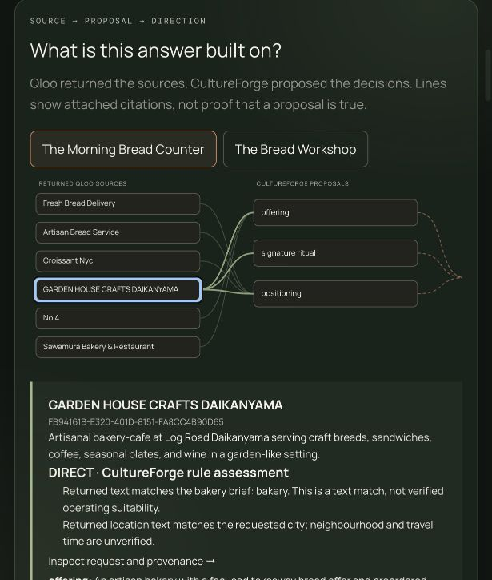

# CultureForge AI

**Concept directions that have to survive their Qloo evidence.** CultureForge
is for location and concept strategists at hospitality and retail groups and
brand agencies. They need to argue which concept fits which neighbourhood,
and defend it. From a brief (business category, specific idea, audience, location),
CultureForge retrieves the audience's Qloo tags, local places and what the
same audience gravitates to beyond places. It composes directions in which
every decision cites its evidence, and then lets the evidence push back: a
bounded agent runs further Qloo workflows, a written policy can return
*contested*, model claims without a Qloo citation are rejected, and
follow-up questions are answered from the evidence or refused. Every number
shown is one Qloo returned. Nothing claims demand, rent, footfall or
willingness to pay.



The studio now assesses reference relevance, resolves explicit business categories, and exposes an initial answer before optional model work. See the [verified implementation review](docs/IMPLEMENTATION_REVIEW.md) and [demo journey](docs/DEMO.md).

## Architecture


More in [docs/ARCHITECTURE.md](docs/ARCHITECTURE.md).

## How Qloo is used

All nine workflows of the official Hackathon Kit harness, each with its own
request builder, cached, and shown in a provenance drawer with allowlisted
query keys.

| Workflow | Used for | Returns | Carried forward |
| --- | --- | --- | --- |
| `find_tags` | Resolve the audience | Up to 3 tags | Tag URNs (`urn:tag:…`) become the audience seeds; a separate exact category tag filters explicit business ideas |
| `recommend` (place) | Local evidence | Up to 10 places with affinity, popularity, rating, price, description, image | Entity IDs; each direction's anchor and citations |
| `recommend` (artist, movie, brand) | The audience bridge: same tags, no location | Up to 5 per domain | Entity IDs, shown as audience-level cross-references |
| `rank` | The evidence test | The places ranked for a demographic profile | Rank position of each anchor |
| `compare_audiences` | The evidence test | Tags for the anchor against every other place | Qualifying cultural tag URNs |
| `where_popular` | Interest map, investigation | Lat/lon interest cells | Drawn as cells, never as venue pins |
| `entity_tags`, `describe`, `audience_demographics`, `trends` | Investigation, agent loop, chat | Tags, metadata, demographic index, time series | IDs added to what the agent may cite |

## How the LLM is used, and validated

The model layer is optional and uses **Vercel AI Gateway only**
(`backend/llm.py`, `backend/reasoning.py`). The studio names the model that
answered.

- **Naming.** It may rename and retag directions. Claims, evidence and
  verdicts stay with the rules, and unsupported numbers are rejected.
- **Agent loop** (`backend/agent.py`). Up to 8 plan-act-observe steps. The
  model picks the next tool from an allowlist, naming only entity IDs and tag
  URNs already observed; the server builds and caches every Qloo request.
  Its analysis is a list of claims, and a claim survives only if every
  citation was observed in this run's envelopes and it states no number of
  its own.
- **Ask the evidence** (`backend/chat.py`). The same allowlist and
  validator, plus at most 3 justified Qloo calls. A question the evidence
  cannot answer gets a refusal.
- **Fallback.** No model, malformed output or no valid claim: the rule
  composer's answer stands, and the trace says so.

## Quick start

**Hosted demo:** not deployed yet. [docs/DEPLOY.md](docs/DEPLOY.md) has the
steps; the URL goes here and in `submission.json`.

**Local** (Node 22.19+, Python 3.10+, a Qloo hackathon key):

```bash
npm ci
python3 -m venv .venv && source .venv/bin/activate
pip install -r requirements-dev.txt
npm install --global @qloo/qloo-harness@0.1.26
cp .env.example .env            # set QLOO_API_KEY; model settings are optional
uvicorn backend.main:app --port 8000
```

```bash
npm run dev                     # then open the printed URL at /studio/
```

Or as the deployed container: `docker compose up --build`, then open
`http://localhost:8000/studio/`. Pick a prepared brief; one marked **Evidence
held** costs no Qloo request. `python3 scripts/prewarm.py` shows which are
held, and `--live` fetches the rest.

## Configuration

`RUN_PROFILE` is the one switch. **dev** enforces the call budgets below;
**judging** lifts every call-count budget and keeps the timeouts, the error
mapping, a cool-down after a Qloo 429, single-flight de-duplication and the
cache. `GET /api/health` reports the profile, each budget (or `unlimited`)
and the cache size. In dev, a budget can be lowered but not switched off: a
value below one becomes one, and the analysis allowance cannot exceed 10.
`backend/tests/test_config.py` fails if this table or `.env.example` drifts
from `backend/config.py`.

| Variable | dev | judging | Meaning | Read in |
| --- | --- | --- | --- | --- |
| `RUN_PROFILE` | dev | judging | Budget profile; unknown values fall back to dev | `config.py` |
| `QLOO_MAX_CALLS_PER_HOUR` | 20 | unlimited | Qloo workflows per hour | `config.py` |
| `QLOO_MAX_CALLS_PER_DAY` | 100 | unlimited | Qloo workflows per day | `config.py` |
| `LLM_MAX_CALLS_PER_HOUR` | 20 | unlimited | Model naming calls per hour | `config.py` |
| `LLM_MAX_CALLS_PER_DAY` | 50 | unlimited | Model naming calls per day | `config.py` |
| `AI_GATEWAY_ANALYSIS_DAILY_LIMIT` | 10 | unlimited | Agent, analysis and chat model calls per day | `config.py` |
| `RESEARCH_RUN_MAX_WORKFLOWS` | 8 | unlimited | Qloo workflows per research run (judging is bounded by the 420 s deadline) | `config.py` |
| `CULTUREFORGE_EVIDENCE_TTL_HOURS` | 24 | 720 | How long held evidence answers | `config.py` |
| `QLOO_LIVE_ENABLED` | true | true | `false` serves held evidence only | `config.py` |
| `QLOO_RATE_LIMIT_COOLDOWN_SECONDS` | 60 | 60 | Pause after two Qloo rate-limit answers in a row | `config.py` |
| `QLOO_MIN_CALL_INTERVAL_SECONDS` | 2 | 2 | Least time between live Qloo requests, server-wide (0 disables) | `config.py` |
| `CULTUREFORGE_BRIDGE_DOMAINS` | artist,movie,brand | same | Audience-bridge domains; `off` disables | `config.py` |
| `QLOO_API_KEY` | — | — | Hackathon key (secret, server only) | `providers.py`, `qloo_exec.mjs` |
| `QLOO_BASE_URL`, `QLOO_TRUSTED_BASE_URL` | hackathon host | same | Set by the Dockerfile; hackathon keys work only against `https://hackathon.api.qloo.com` | Dockerfile, `check_api.py` |
| `PORT` | 8000 | same | Port the container listens on | Dockerfile |
| `BASE_URL`, `DEV_URL` | local | — | Targets of the `verify_*` scripts | `scripts/verify_*.mjs` |
| `QLOO_REQUEST_TIMEOUT_MS` | 60000 | same | Per-request Qloo timeout | `scripts/qloo_exec.mjs` |
| `QLOO_MAX_ATTEMPTS` | 1 | same | HTTP attempts per request (no blind retries) | `scripts/qloo_exec.mjs` |
| `QLOO_CLI`, `QLOO_HARNESS_PATH` | — | — | Override the harness command or package path | `providers.py`, `qloo_exec.mjs` |
| `CULTUREFORGE_PROVIDER` | auto | auto | `auto`/`qloo` need a key; `mock` is the test fixture only | `providers.py` |
| `AI_GATEWAY_ENABLED` | false | false | Turns the model layer on | `llm.py` |
| `AI_GATEWAY_API_KEY`, `AI_GATEWAY_MODEL` | — | — | Vercel key (secret) and model id | `llm.py` |
| `AI_GATEWAY_DISPLAY_MODEL` | model id | same | Readable name shown for the model | `llm.py` |
| `LLM_TIMEOUT_SECONDS` | 30 | same | Naming request timeout | `llm.py` |
| `LLM_REQUESTS_PER_MINUTE` | 5 | 5 | Model requests that may start in a rolling minute (pacing, not a budget; 0 disables) | `modelpace.py` |
| `CULTUREFORGE_CACHE_DIR` | `~/.cache/cultureforge` | same | Evidence store and `budget.db` | `evidence_store.py`, `ledger.py` |
| `CULTUREFORGE_DB` | `~/.cache/cultureforge/platform.db` | same | Workspaces and saved explorations | `platform.py` |
| `CULTUREFORGE_STATIC_DIR` | unset | same | Serve the built UI (set in Docker) | `main.py` |
| `CULTUREFORGE_PDF_FONT` | auto-detected | same | A `.ttf` that covers non-Latin text, for the PDF (the Docker image installs one) | `report_pdf.py` |
| `CULTUREFORGE_ALLOWED_ORIGINS` | empty | same | Extra CORS origins if the UI is hosted elsewhere | `main.py` |
| `CULTUREFORGE_KEY_SALT` | dev default | set it | Salt for issued workspace keys | `platform.py` |
| `CULTUREFORGE_OPERATOR_TOKEN` | unset | unset | Opens operator routes away from localhost | `main.py` |
| `CULTUREFORGE_API_TARGET` | `http://127.0.0.1:8000` | — | Where the Vite dev server proxies `/api` | `vite.config.ts` |

## API

FastAPI documents every route at `/docs`. The main ones:

| Route | Purpose |
| --- | --- |
| `GET /api/health` | Readiness, profile, budgets, cache; no upstream call |
| `GET /api/examples` | Prepared briefs and whether each is held |
| `POST /api/research/runs` → `GET /api/research/runs/{id}` | The observable research run, with agent steps |
| `POST /api/projects/generate` | Answer a brief directly |
| `POST /api/projects/challenge` | The evidence test (anchor-fit-4), with an optional anchor and profile |
| `POST /api/chat` | Ask the evidence |
| `POST /api/report/pdf` | The PDF report |

The full table and the error envelope are in [docs/API.md](docs/API.md).

## Checks

```bash
npm run lint && npm run build
python -m pytest backend/tests -q        # none of these tests can reach Qloo or a model
npm run test:unit && npm run check:submission
python3 scripts/smoke_test.py <url>      # a running deployment, no quota spent
```

CI runs all of these except the smoke test, with coverage.

## Limits and non-claims

- The verdict is about **anchor fit within the retrieved sample**: at most
  ten places, ranked against one demographic profile that CultureForge
  proposes and the reader can change. Confidence is never higher than
  *moderate*.
- No demand, revenue, footfall, rent, competition or willingness to pay is
  measured or implied. No customer validation exists yet; the commercial
  case is a set of assumptions in [docs/BUSINESS.md](docs/BUSINESS.md).
- The model layer is optional; its validator checks citations and numbers,
  not the soundness of reasoning.
- The deployment is one process and one instance. The judging profile lifts
  local budgets, not Qloo's own quota, so prewarm first.
- The background video's Safari handling (`muted`, `playsinline`, a guarded
  `play()`, a poster) is in `main.js`. It was checked in Chromium, not in
  Safari.

The full list is in [docs/LIMITATIONS.md](docs/LIMITATIONS.md). Also see
[EVIDENCE_POLICY](docs/EVIDENCE_POLICY.md), [DEPLOY](docs/DEPLOY.md),
[JUDGING_DAY](docs/JUDGING_DAY.md), [DEMO](docs/DEMO.md),
[SUBMISSION](docs/SUBMISSION.md), [CHANGELOG](CHANGELOG.md) and
[THIRD_PARTY_NOTICES](THIRD_PARTY_NOTICES.md). MIT licensed.
