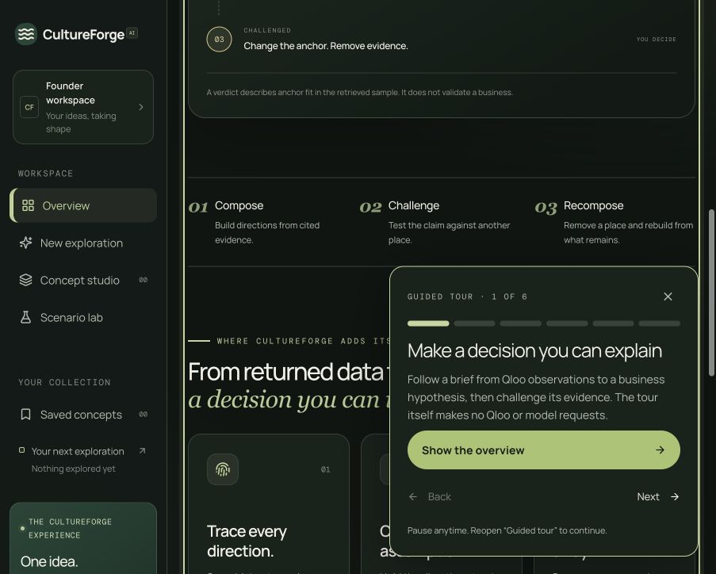
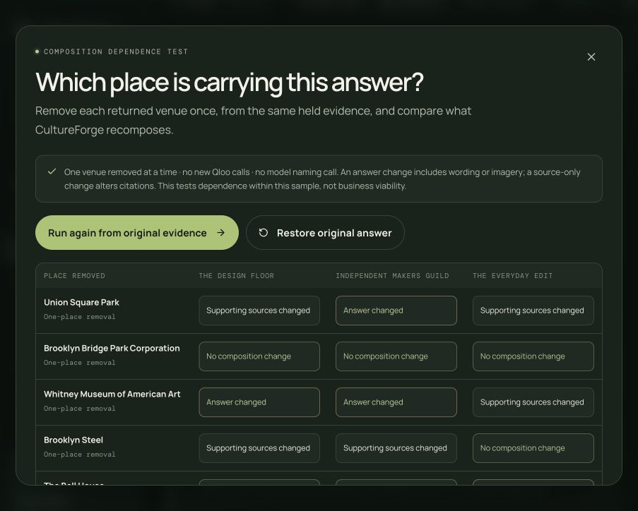
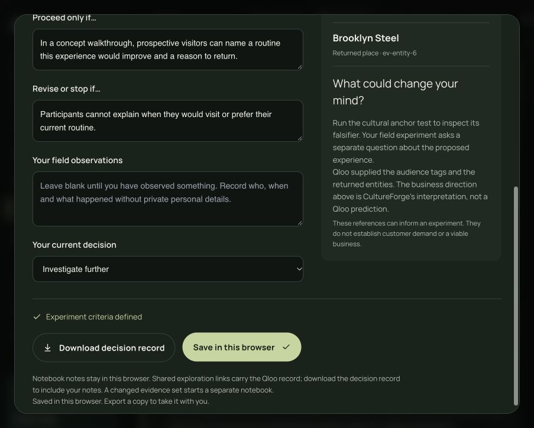
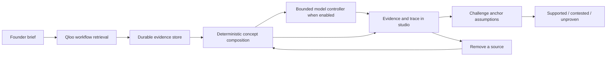

# CultureForge AI

**Business ideas that answer to their cultural evidence.**

CultureForge helps independent founders decide which local experience to prototype. It connects an audience and location to real Qloo cultural signals and reference places, composes business hypotheses, then lets the founder challenge an anchor or remove evidence and rebuild the answer.

**Submission status:** local review build; public demo pending deployment. [Source repository](https://github.com/joyboyreturns/CultureForge-AI) · [MIT license](LICENSE) · [Judge walkthrough](docs/JUDGE_WALKTHROUGH.md) · [Deployment](docs/DEPLOYMENT.md) · [Devpost draft and checklist](docs/SUBMISSION.md) · [Final review results](docs/FINAL_REVIEW.md)

> A verdict assesses **anchor fit within the retrieved sample**. It does not measure demand, revenue, profitability, rent or willingness to pay.

## Try the central interaction

New here? Open **Guided tour** in the studio header, or visit `/studio/?tour=1`. The six-step tour works with an empty workspace, can be resumed, and starts no upstream request.



1. Open `/studio/` and choose **Run the example brief**, or describe your business, audience and location. The guided route lets you confirm Qloo audience signals.
2. Inspect the proposed directions. Each decision names the evidence and rule that produced it. Open provenance to see the workflow, allowlisted request, returned excerpt and timing.
3. Choose **Test the evidence**. The result can be supported, contested or unproven. Read the claim, falsifier, scope and policy. A partial answer remains unproven.
4. Change the anchor. The concept stays fixed while the verdict is tested against another returned place; the original reference and changed assumption stay visible.
5. Choose **Trace evidence dependence** and remove a venue. Descriptions, photos, citations and anchors are recomposed from what remains. A direction can disappear.
6. Export the brief or share a frozen exploration with its recorded verdict. The share link opens directly in the studio.
7. Open **Decision notebook** to define a field experiment, proceed/stop criteria and your current decision. Save locally or download a decision record with its citations. Founder observations start blank, remain separately labelled, and do not change a Qloo verdict. Recomposition starts a separate notebook when the proposal or evidence changes.

The short [judge walkthrough](docs/JUDGE_WALKTHROUGH.md) includes failure paths. Output depends on Qloo evidence; three usable directions or a changed verdict are not guaranteed. A failed lookup never becomes mock evidence.





## Why this needs Qloo

Without Qloo, CultureForge has no cultural signals, source venues or basis for its comparisons. Qloo retrieves the observations. CultureForge proposes interpretations and exposes their dependencies. Removing a Qloo source can change what the product is able to say.

Business consultation and cultural venture ideation appeared in earlier Qloo submissions. Our focus is the next step: **make the idea falsifiable**. The [competitive review](docs/COMPETITIVE_REVIEW.md) examines GeoTaste, Alloy, Resonance AI, Zesty and TAVA, with links and an explicit distinction between published claims and verified CultureForge behavior. It does not claim a measured advantage over those projects.

The [judge assessment](docs/JUDGE_ASSESSMENT.md) states the remaining weaknesses and includes a founder-validation protocol for the final sprint.

## The agent and architecture



- **Frontend:** React, TypeScript, Vite, Tailwind CSS and Lucide; responsive light/dark studio and a cinematic introduction.
- **HTTP contracts:** FastAPI and Pydantic; typed requests and a consistent readable error envelope.
- **Qloo:** official [Hackathon Kit](https://github.com/qloo/qloo-hackathon-kit) harness, with workflow-specific request builders and a timeout-aware wrapper that disables blind transport retries.
- **Research:** an observable state machine. Optional model control makes one schema-checked plan, at most one allowlisted evidence test, and reflection. Investigations use named, typed workflows.
- **Optional models:** Vercel AI Gateway exclusively. A model may name directions, select existing evidence or interpret cited observations. Deterministic rules retain factual claims, citations and verdicts. Unavailable or invalid model output leaves the rule-based result intact and reports its state. The studio and trace name the model that answered: `AI_GATEWAY_DISPLAY_MODEL` if set, otherwise the configured `AI_GATEWAY_MODEL` id.
- **Persistence:** durable evidence files and SQLite workspaces, saved explorations, share links and usage. The production package uses one process and a persistent volume.

Exact workflow contracts are exposed at `/api/qloo/workflows`; API documentation is at `/docs`.

## Trust and cost

Every displayed Qloo measurement is returned by Qloo. CultureForge does not invent fit percentages. Citation counts measure attachment, not correctness. The demographic profile used by the ranking workflow is proposed by CultureForge from the brief; it is not Qloo-inferred, and is not the audience's complete cultural profile.

The server caches successful evidence for 24 hours in the dev profile and 14 days in judging. The browser holds composed live answers for 12 hours. Both are labelled, and a reused answer reports zero new upstream requests. Failures are not cached as successful evidence. Opening the landing page does not run a lookup; the example is explicit.

A basic brief typically needs two Qloo workflows; a three-direction challenge can add one ranking and three comparisons. Optional investigation/model-selected tests can add calls. Held evidence is reused.

### Run profiles

`RUN_PROFILE` (in [backend/config.py](backend/config.py)) is the one switch. `dev`, the default, enforces the local call budgets below. `judging` turns every call-count budget off, for Qloo and the model gateway alike. Both profiles keep the per-request timeouts, the stated handling of 429/401/5xx, a pause after a 429 instead of a retry, single-flight de-duplication and the evidence cache. Qloo's own server-side quota still applies, so run `python3 scripts/prewarm.py --live` against the serving instance before judging. `QLOO_LIVE_ENABLED=false` serves held evidence only. `GET /api/health` reports the active profile, each budget (or `unlimited`), and the cache size.

| Variable | dev | judging |
| --- | --- | --- |
| `QLOO_MAX_CALLS_PER_HOUR` | 20 | unlimited |
| `QLOO_MAX_CALLS_PER_DAY` | 100 | unlimited |
| `LLM_MAX_CALLS_PER_HOUR` | 20 | unlimited |
| `LLM_MAX_CALLS_PER_DAY` | 50 | unlimited |
| `AI_GATEWAY_ANALYSIS_DAILY_LIMIT` | 10 | unlimited |
| `RESEARCH_RUN_MAX_WORKFLOWS` | 3 | unlimited |
| `CULTUREFORGE_EVIDENCE_TTL_HOURS` | 24 | 336 |

In dev, the environment can change a budget but not switch it off: a value below one becomes one, and the analysis allowance cannot be raised above 10. Do not raise limits to work around errors. `backend/tests/test_config.py` fails if this table or `.env.example` drifts from `config.py`.

## Run locally

Requires Node.js **22.19+** and Python **3.10+**. The tested deployment target is Python 3.12.

```bash
npm ci
python3 -m venv .venv
source .venv/bin/activate
pip install -r requirements-dev.txt
cp .env.example .env
npm install --global @qloo/qloo-harness@0.1.26
qloo setup --qloo
qloo config set base-url https://hackathon.api.qloo.com
```

Configure your private hackathon key through `qloo setup --qloo` or server-only `QLOO_API_KEY`. Replace the template value in `.env`; never put credentials in `VITE_*` variables or tracked files. Hackathon keys require the hackathon endpoint. Optional Vercel settings are documented in `.env.example`; model use is an explicit opt-in.

Start these in separate terminals:

```bash
source .venv/bin/activate
uvicorn backend.main:app --reload --port 8000
```

```bash
npm run dev
```

Open the Vite URL, then `/studio/`. If port 8000 is unavailable, set `CULTUREFORGE_API_TARGET=http://127.0.0.1:8011` when starting Vite and run the API on 8011.

`python3 scripts/check_api.py` and `python3 scripts/llm_check.py` check configuration without upstream requests. `--live` deliberately spends a request; do not run live checks repeatedly.

## Publish

The [deployment guide](docs/DEPLOYMENT.md) covers a Docker service that serves both the built UI and API from one origin. Static-only hosting is insufficient. Use one worker, one replica and persistent storage; research runs are currently held in process memory.

```bash
docker build -t cultureforge .
docker run --rm -p 8000:8000 --env-file .env -v cultureforge-data:/data cultureforge
```

Review before publishing. Record the public HTTPS root URL and owner confirmations in [submission.json](submission.json), and replace the pending demo status above with its link. Keep secrets in the host's private environment panel.

## Verify

```bash
npm run build
python -m pytest backend/tests -q
npm run test:unit
npm run check:submission
```

The backend suite isolates storage and uses explicit test fixtures; it spends no live Qloo or model quota. CI runs build, unit/backend tests and packaging checks. A packaging pass does not certify a public deployment.

After publishing:

```bash
npm run check:release
```

This checks public routes and provider configuration without upstream requests. Also complete the [manual walkthrough](docs/JUDGE_WALKTHROUGH.md) on the hosted URL. The existing `test:contracts`, `test:endpoints` and `test:walkthrough` scripts exercise a running backend and may spend quota if required evidence is missing; use them deliberately.

## Submission readiness and limits

Prepared for the [2026 Qloo Agentic Hackathon](https://qloo.devpost.com/). The required public demo is still pending. The repository now includes an open-source license, a Devpost text draft, deployment instructions, a competitor review and a manual judge journey. Owner eligibility and asset rights require confirmation. See [the handoff](docs/SUBMISSION.md) for dates and outstanding steps.

The public demo workspace is shared; use non-confidential example briefs. Cultural fit is a research starting point, not a validated business plan. No customer traction, demand validation or competitor performance advantage is claimed. See [third-party notices](THIRD_PARTY_NOTICES.md) for dependency and asset attribution.
