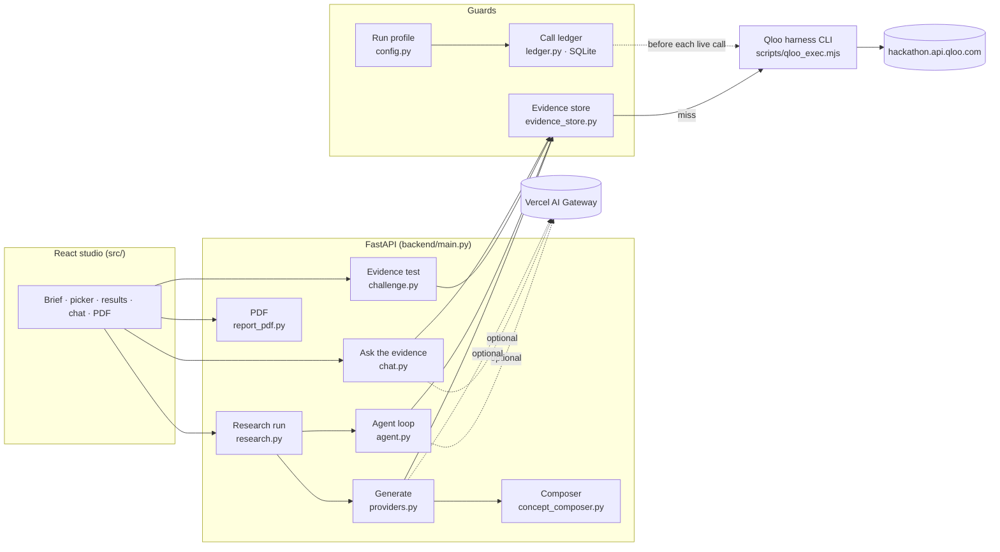

# Architecture



## A brief, end to end

1. **Seeds.** `find_tags` turns "business type + audience" into up to three
   Qloo tags (`brief_tags_payload`).
2. **Places.** `recommend` with those tags and the location returns up to
   ten places (`brief_places_payload`).
3. **Audience bridge.** The same tags go to `recommend` for each bridge
   domain (`bridge_payload`, no location), fetched in parallel.
4. **Composition.** `concept_composer.compose` matches the tags against
   eight recipes. Each recipe picks its reference place by a stated ordering
   (popularity, rating, price level or least-mainstream), and every decision
   cites evidence IDs. Composition is deterministic.
5. **Naming (optional).** The model may rename and retag the directions. It
   cannot change claims or evidence, and its wording is validated.
6. **Agent loop (optional).** Up to eight steps, each choosing an
   allowlisted tool, with requests built and cached by the server. The
   analysis is validated against the identifiers observed in this run.
7. **Evidence test (on request).** One `rank` call and one
   `compare_audiences` call per direction, judged by policy anchor-fit-4
   ([EVIDENCE_POLICY.md](EVIDENCE_POLICY.md)).

Every Qloo workflow goes through `run_workflow_cached`:

```
evidence store hit? -> answer, 0 requests
miss -> single-flight (concurrent duplicates wait) -> kill switch? -> 429 cool-down?
     -> ledger reserve (budget, if the profile has one) -> harness CLI (60 s, 1 attempt)
     -> stated error code, or store the envelope -> answer
```

Failures are never cached. A held envelope answers for 24 hours in dev and
14 days in judging.

## Where things live

| Module | What it owns |
| --- | --- |
| `backend/main.py` | The HTTP surface: typed requests, one error envelope, status codes that mean something |
| `backend/config.py` | The run profile and every limit, read at call time |
| `backend/providers.py` | The Qloo provider: one payload builder per workflow, the transport, error mapping, generation |
| `backend/ledger.py` | The Qloo, naming and analysis call ledgers (SQLite, `BEGIN IMMEDIATE`) |
| `backend/evidence_store.py` | The durable evidence cache, single-flight de-duplication and snapshots |
| `backend/concept_composer.py` | The rules that turn evidence into directions |
| `backend/research.py` | The observable run state machine |
| `backend/agent.py` | The bounded agent loop and the citation validator |
| `backend/chat.py` | *Ask the evidence* |
| `backend/challenge.py` | Policy anchor-fit-4 |
| `backend/report_pdf.py` | The PDF |
| `backend/llm.py`, `backend/reasoning.py` | The only model transport (Vercel AI Gateway), with schema-checked output |
| `backend/examples.py`, `shared/demoBriefs.json` | The prepared briefs and their held state |
| `backend/platform.py` | Workspaces, keys, saved explorations, metering (SQLite) |
| `scripts/prewarm.py`, `scripts/smoke_test.py` | Judging-day operations |
| `src/` | The studio; `src/api.ts` throws a readable error and never invents an answer |

## Rules the tests hold

- No mock data in the product path. `MockCultureProvider` is reachable only
  with `CULTUREFORGE_PROVIDER=mock`, for tests.
- The test suite cannot reach Qloo or a model: `conftest.py` replaces
  `subprocess.run` and `urllib.request.urlopen` with guards that fail the
  test.
- Payload builders are pinned to a snapshot, because a changed payload
  makes every held entry go cold.
- The README and `.env.example` budget defaults must match `config.py`.
